# Mockups de tela (TV)

Telas completas do Xplay em 1920×1080 para Fire TV, Android TV e Mi Box. Os nomes, canais e capas são fictícios.

| | |
|---|---|
| 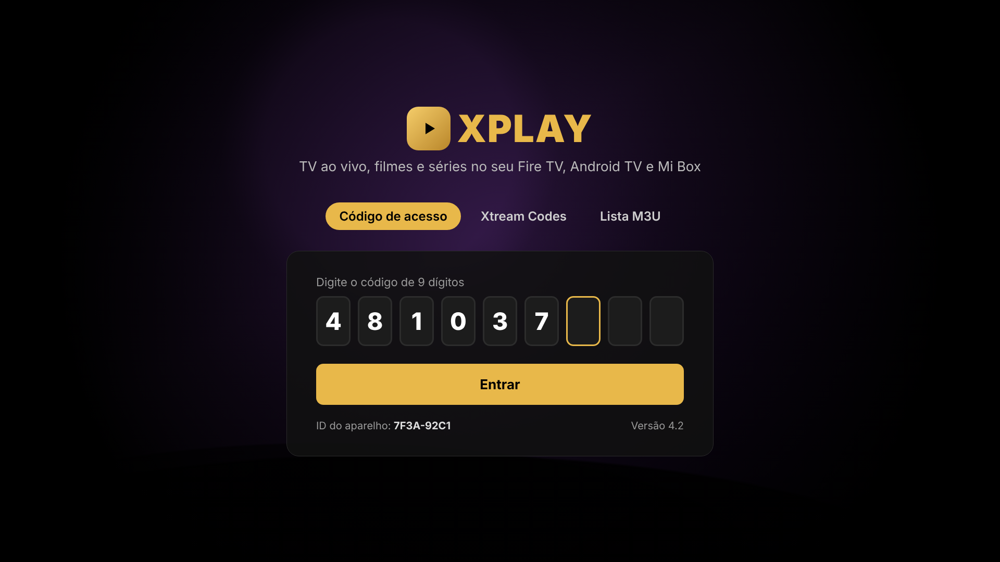 Login por código | 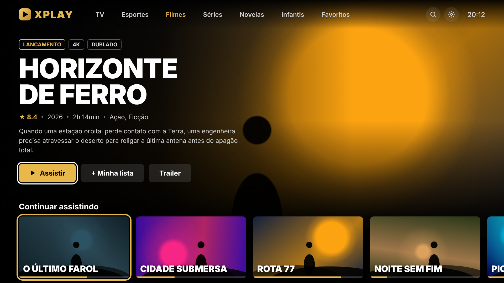 Início |
| 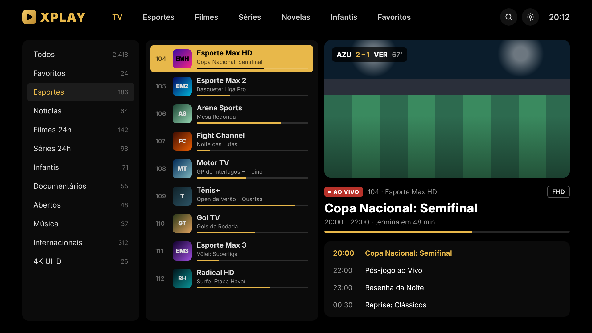 TV ao vivo | 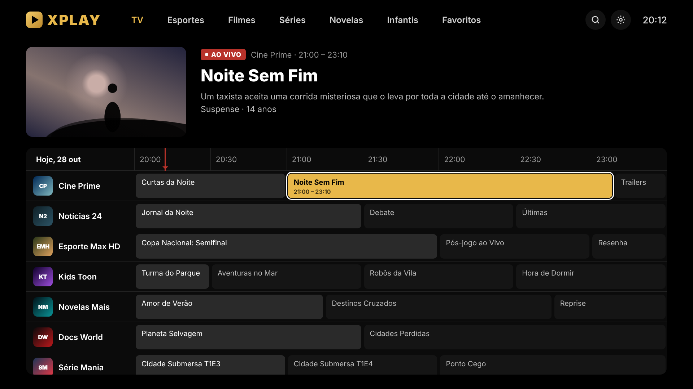 Guia (EPG) |
| 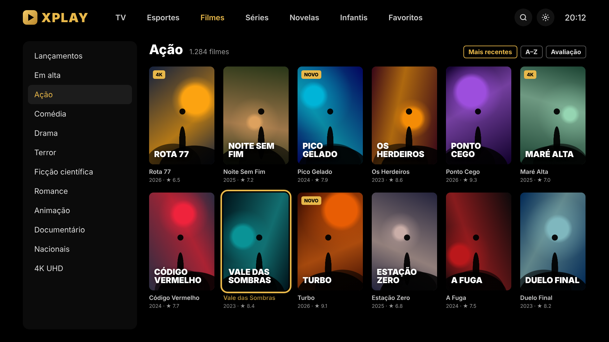 Filmes | 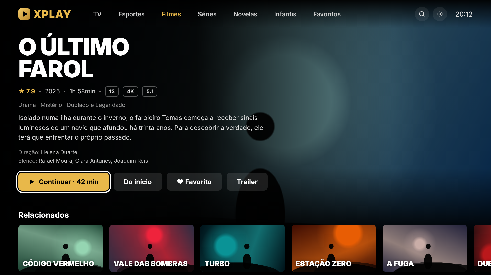 Detalhes do filme |
| 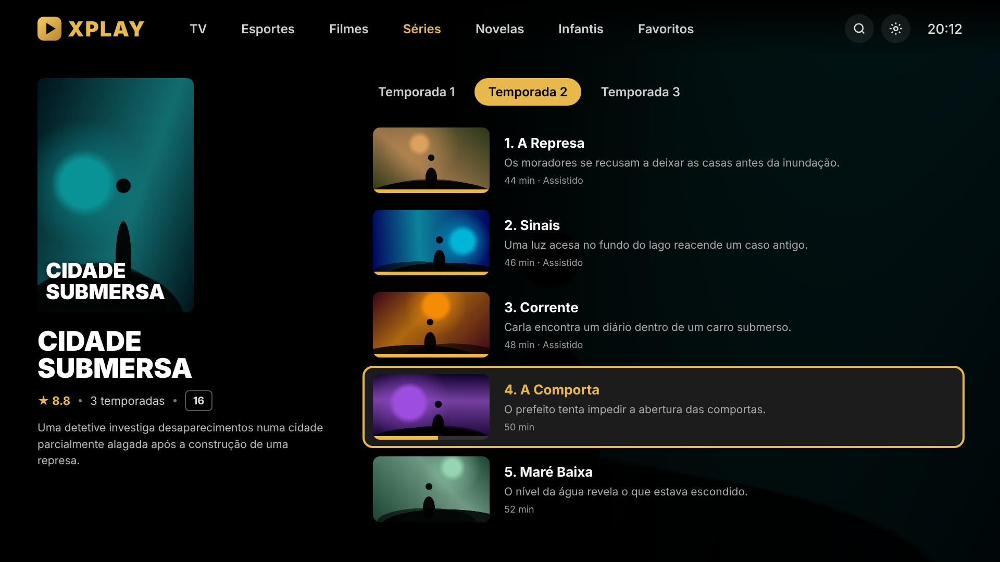 Séries e episódios | 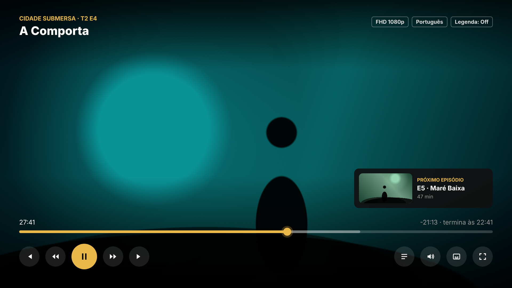 Player |
| 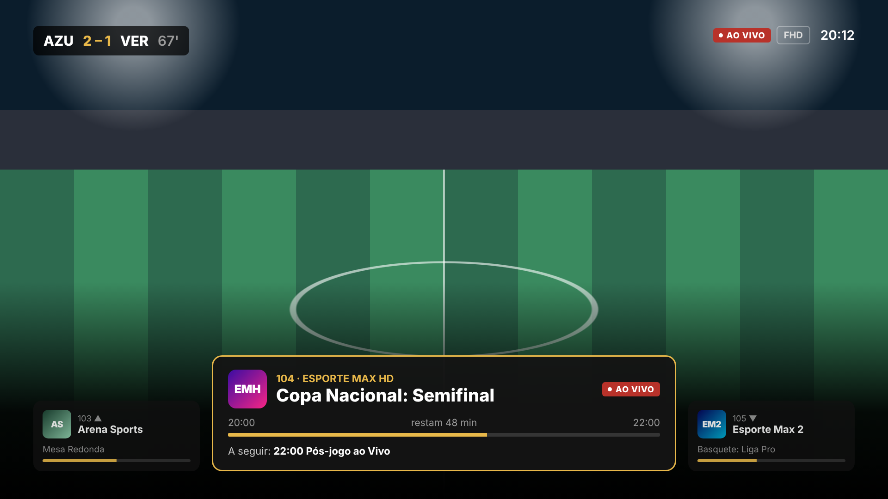 Player ao vivo | 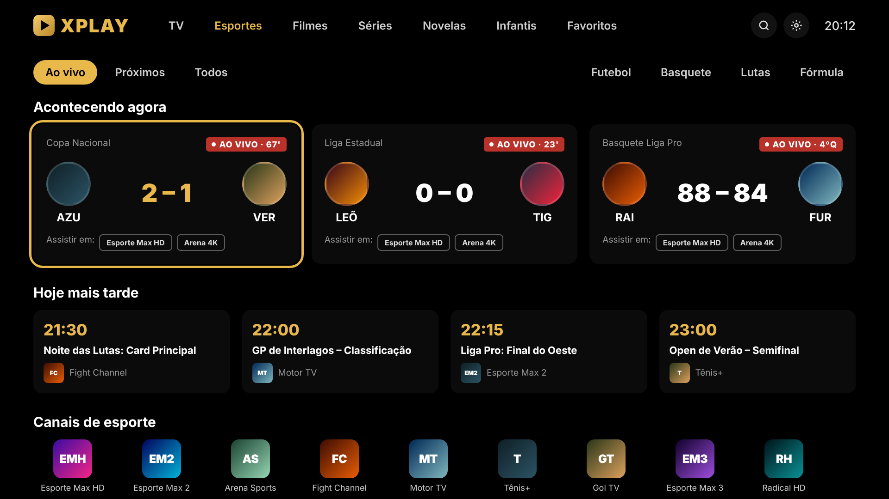 Esportes |
| 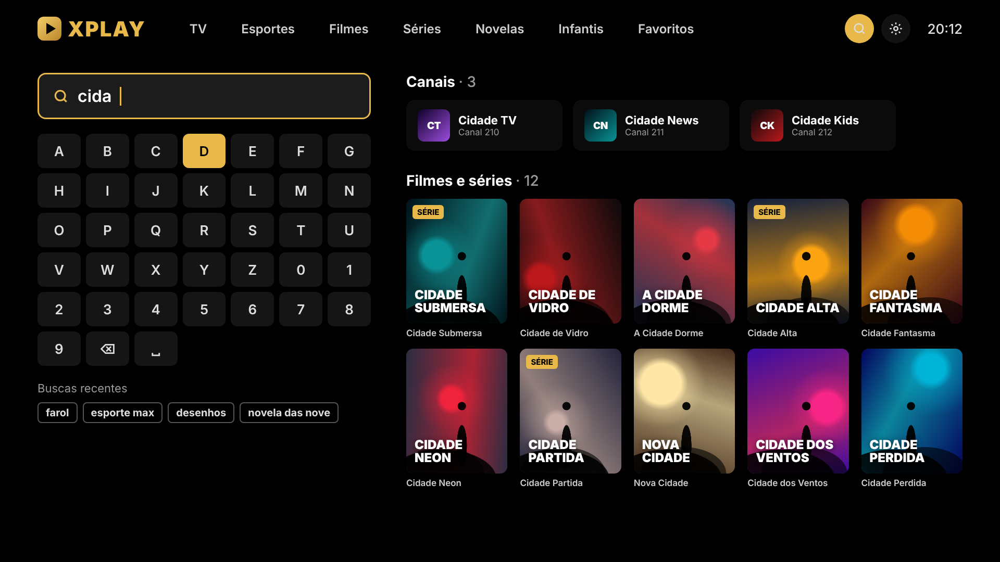 Busca | 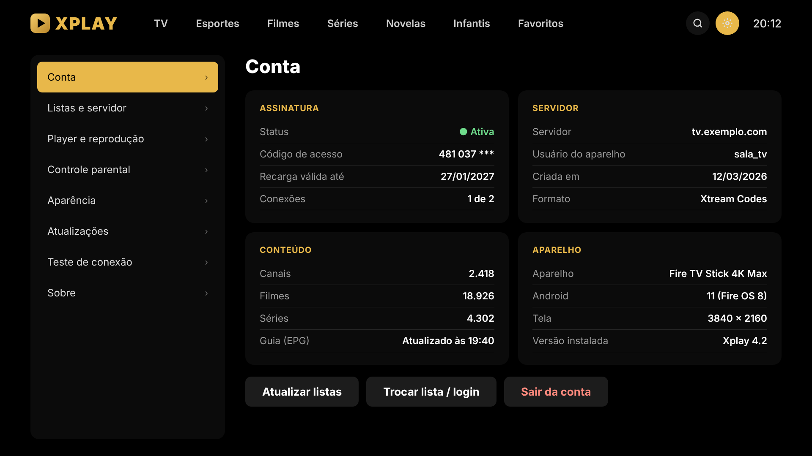 Configurações |

Para gerar de novo: edite `tools/mockups/screens.html` e rode `node tools/mockups/render.js`.
